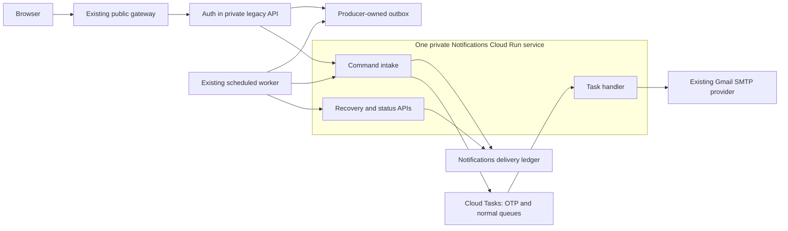

# Milestone 3: Notifications and signup email verification

Planning date: 9 November 2026. Implementation prepared on 10 November 2026; deployment and cloud acceptance remain pending. See [the release guide](milestone-3-release.md) for the implemented configuration and release sequence.

## 1. Outcome and agreed scope

Milestone 3 is **Extract Notifications** in the [architecture roadmap](micro_service_architecture.md). It moves email transport, delivery attempts, retries, and delivery records into one private Cloud Run service. Business modules continue to decide who receives an email and why.

The additional signup requirement has two confirmed decisions:

1. **Verify the email before creating the account.** Requesting or verifying a code does not create a user.
2. **Use separate request/resend and verification endpoints.** Account creation remains on the existing signup endpoint and requires the verification result.

The rollout targets the development deployment in `planar-ray-472112-e8`, `us-west1`. It keeps the current public API URL and Gmail SMTP provider. Production, unrelated applications, billing configuration, a database upgrade, new projects, and separate preview infrastructure are outside this milestone. Identity extraction belongs to Milestone 4; Support/Zoom extraction belongs to Milestone 5.

## 2. Starting point and implications

These are source findings and the recorded Milestone 2 deployment baseline. Live revisions, IAM, schedules, and capacity must be checked again before applying the rollout.

| Finding | Consequence for this milestone |
| --- | --- |
| `nordikdriveapi` is the public gateway; business handlers and scheduled work run in `nordikdriveapi-legacy` and `nordikdriveapi-worker`. | Add a separate private `nordikdriveapi-notifications` service. Keep signup behind the existing gateway. |
| [Auth routes](../internal/auth/routes.go) already expose `/api/user/send-otp` and `/api/user/reset-password`. | Those routes are for password resets. New signup codes must have a separate purpose and storage. |
| [Signup](../internal/auth/controller.go) currently creates an account without email verification and does not log the user in automatically. | Add proof validation to signup; preserve its successful response and subsequent login flow. |
| [Auth models](../internal/auth/model.go) have no email-verification timestamp; existing email uniqueness is case sensitive. | Add a nullable timestamp for newly verified registrations. Inspect existing email case/whitespace collisions before changing comparison or uniqueness rules. |
| Domains call [the SMTP mailer](../internal/mailer/email.go) directly. Review jobs send before recording success. | Refactor actual transaction boundaries and call sites, rather than replacing `SendOne` with a remote HTTP call. |
| The frontend signup component creates missing communities before calling signup. | In `C:\Nordik Projects\nordik-drive\src\pages\auth\Signup.tsx`, defer those calls until email verification succeeds. |
| Gateway rate limiting is currently in observe mode. | Enforce signup-specific limits in auth; do not rely on the gateway's current global mode to protect OTP endpoints. |

Existing users keep their IDs, passwords, login behavior, and cookies. Their new verification timestamp remains unknown unless a future explicit workflow verifies them; this release must not silently mark them verified or require them to repeat signup. Preserve the current JWT value and password policy.

## 3. The signup experience and API contract

### User sequence

1. The user enters an email address and requests a code.
2. Auth records a challenge and an email intent together. The UI says that the request was accepted, rather than claiming inbox delivery.
3. Notifications sends the email. The user enters the six-digit code.
4. Auth verifies the code and returns a short-lived, single-use signup proof. No account or login session exists yet.
5. The user submits the signup form with that proof. Auth creates the account and consumes the proof in one database transaction.
6. A welcome email is recorded with that account transaction. The existing signup-success navigation and login behavior continue.

The UI may collect the other form fields before verification, but it must not submit a password, create communities, or create an account merely to request an OTP. Editing the email clears the active challenge and proof. Keep the proof in memory; do not put codes, passwords, or proofs into URLs, analytics, or browser persistent storage.

### Proposed public endpoints

The names below are implementation proposals. Two new routes are required; the third is the existing signup route with one additional field.

| Endpoint | Request | Result |
| --- | --- | --- |
| `POST /api/user/signup/otp/request` | `{ "email": "person@example.com" }` | `202` with opaque `challenge_id`, `expires_at`, and `resend_after`. This same route handles resend. |
| `POST /api/user/signup/otp/verify` | `{ "email": "person@example.com", "challenge_id": "...", "otp": "012345" }` | `200` with opaque `signup_verification_token` and `expires_at`. It does not issue access or refresh cookies. |
| `POST /api/user/signup` | Existing signup fields plus `signup_verification_token`. | Existing successful `201` response, after atomically validating and consuming the proof. |

Each operation uses an `Idempotency-Key` header. A network retry with the same key and same request returns the original result without generating another code, consuming another attempt, or creating another user. An intentional resend or a new code-entry attempt uses a new key. Reusing a key with a different request returns a conflict. Store keyed request fingerprints and protected replay responses; never store signup passwords or raw password hashes for this purpose.

Use `429` with `Retry-After` for throttling. Invalid, expired, superseded, or exhausted codes return a consistent verification error. A failed durable challenge/outbox write returns an error, not `202`. A delayed SMTP provider does not erase an accepted request. The request endpoint must not disclose whether an account exists. An already registered email follows the same ownership-check flow; account creation reports the existing-account conflict only after valid proof is presented.

Add `Idempotency-Key` to the backend CORS allowlist in [application setup](../cmd/server/application.go). Test browser preflights through the gateway from `https://nordik-drive-react-724838782318.us-west1.run.app`; do not infer success from a direct backend request.

### OTP validity, storage, and abuse controls

The following are **proposed initial settings**, not previously confirmed requirements:

| Setting | Initial proposal | Reason |
| --- | --- | --- |
| Code | Six decimal digits, including leading zeroes | Familiar email verification flow; always treat it as a string. |
| Code lifetime | 10 minutes from generation, using database time | Queue delay must not extend validity. |
| Resend cooldown | 60 seconds | Limit accidental duplicates and email flooding. |
| Incorrect codes | At most 5 per challenge | Bound online guessing. |
| Send limits | 5 per email/hour; 20 per email/day; 50 per source IP/15 minutes | Apply persistent limits across resends and replicas; check shared-network behavior before activation. |
| Verification limit across challenges | 10 failures per email/15 minutes; 100 per source IP/15 minutes | A resend must not reset the attacker's entire guessing budget. Check the IP ceiling against shared-network tests before activation. |
| Signup proof | 32 random bytes; 10-minute lifetime; single use | Separate email ownership proof from login tokens. |

Generate codes and proofs with `crypto/rand` and handle random-source errors. Store a keyed verifier bound to challenge, email, and `signup` purpose; a bare hash of a six-digit code is insufficient protection against offline guessing. Compare verifiers in constant time. Store proof verifiers rather than plaintext proofs, with a bounded encrypted replay record where needed for idempotent responses.

Resend atomically supersedes the prior challenge, creates a new challenge, and records the new email intent. Only the latest challenge can verify. A successful verification consumes the code; an idempotent retry can replay its original proof result. Final signup locks/consumes the proof with the user insert and welcome-email outbox write. Failed transactions leave the proof usable; concurrent submissions create at most one account. Handle lost signup responses through idempotency rather than telling a successfully registered user that their proof is invalid.

Use one email-validation/comparison rule consistently across request, verify, and signup. Start with an audit of existing rows and current trim-only frontend normalization. Do not introduce unconditional lowercasing, Gmail dot/plus rewriting, automatic account merges, or a new case-insensitive index without resolving collisions and documenting the policy.

Auth owns challenge/attempt state and enforcement. Forward a client IP that the gateway derives from its verified proxy configuration, overwriting any browser-supplied copy. The private backend trusts that value only from the gateway identity. Do not trust arbitrary `X-Forwarded-For` values or read the gateway's schema from auth. Reuse the existing gateway enforcement mode for other routes.

These controls apply secure, expiring, single-use verification principles from [OWASP email verification](https://cheatsheetseries.owasp.org/cheatsheets/Email_Validation_and_Verification_Cheat_Sheet.html) and [OWASP recovery-token guidance](https://cheatsheetseries.owasp.org/cheatsheets/Forgot_Password_Cheat_Sheet.html). Email ownership verification is not a replacement for the user's password or a new MFA claim.

## 4. Notifications ownership and durable delivery

Notifications owns only its `notifications` schema. Auth, Records, and Support retain their user lookups, recipient selection, business rules, and current template content. Notifications receives a finalized, versioned delivery command; it does not query users, files, forms, support requests, or Zoom tables. Future extractions move each producer's outbox with its business owner.

### One delivery, from transaction to provider

1. The producer commits its business change and one outbox intent per recipient in the **same SQL transaction**. Initial legacy/worker outboxes remain in their producer-owned `public` schema, with grants limited to those runtimes.
2. After commit, signup OTP may make a bounded intake attempt while its HTTP request is active. An existing-worker dispatcher recovers all remaining intents on a proposed one-minute schedule. There is no untracked goroutine after the response.
3. Private `POST /internal/v1/notifications` authenticates the producer, validates the command, and commits a unique delivery record before acknowledging acceptance. Uniqueness is on producer plus idempotency key. A matching retry returns the same receipt; a different payload under that key conflicts.
4. Notifications enqueues a Cloud Task containing **only the delivery ID**. If enqueueing fails, the committed delivery remains `pending_enqueue`. The worker invokes a private Notifications recovery operation to retry this state; it never queries the Notifications schema itself.
5. The task invokes private `POST /internal/v1/deliver`. Notifications claims a bounded lease, commits, releases its SQL connection, and calls the provider. A short transaction then records the result. No SQL transaction or row lock spans SMTP, object download, or Cloud Tasks calls.
6. A known provider acceptance becomes `provider_accepted`; permanent errors, expiry, retry exhaustion, and uncertain outcomes remain distinguishable durable states. Neither `202` intake acceptance nor task creation means an email was sent.
7. Producers obtain delivery status through a private batch API when their legacy business flags need it. They update their own tables. Notifications never writes back into another domain's tables.

The worker dispatcher must release database row locks before intake calls and use small bounded batches/time budgets. Its existing job runner holds an advisory-lock session during a job; that session and the worker's second connection remain part of its current allocation. Reuse this worker instead of adding another service or database pool.

### Delivery command and sensitive data

Define a `v1` command with producer, event type/version, stable idempotency key, creation time, delivery deadline, optional supersession group/version, and encrypted payload. The payload contains the finalized recipient, permitted template/version or rendered subject/body, and attachment references. Use a keyed payload fingerprint for conflict detection without exposing a low-entropy OTP. Restrict sender identity and permitted event/template types by authenticated producer; this must not become a general email relay.

Use a versioned authenticated-encryption key for queued payloads, including OTP text. Neither Cloud Task bodies nor logs contain codes, proofs, SMTP credentials, message bodies, or attachment bytes. Keep authentication's OTP/proof key separate from the notification-payload key and from the existing JWT secret. Pin secret versions; retain decryption/verification versions until their active challenges and backlog have drained.

Remove OTP payload material when it is no longer needed, and never deliver it beyond its deadline. Apply a separate bounded retention period to ordinary encrypted email payloads needed for failed-delivery replay. Retain minimal deduplication/producer-reference metadata for as long as the owning event can be replayed; payload cleanup must not permit an old review event to be mailed again.

### Retries, duplicates, and uncertain SMTP results

Cloud Tasks can redeliver. The database ledger, not a task name or in-memory cache, prevents a completed delivery from being executed again. Separate OTP and normal queues allow different deadlines and dispatch controls; they do not guarantee priority on a single-instance service. Queue timing and email inbox arrival are not guaranteed. Measure signup latency with both a normal-email backlog and a cold service. [Cloud Tasks delivery model](https://docs.cloud.google.com/tasks/docs/dual-overview)

Propose at most five **safe provider attempts** and an explicit delivery deadline, enforced by the application ledger as well as queue configuration. Recovery cannot reset those limits. Persist permanent failure/expiry/unknown states and acknowledge the task after recording them; a database failure that prevents recording an outcome must not be acknowledged as success. Configure finite queue retries and document their interaction with task retention. [Cloud Tasks retry reference](https://docs.cloud.google.com/tasks/docs/reference/rpc/google.cloud.tasks.v2#retryconfig)

SMTP cannot provide an atomic transaction with PostgreSQL. If SMTP may have accepted a message but recording the result failed, or a `sending` lease is abandoned after a crash, mark it `unknown` for reconciliation rather than automatically sending a second message. Normal-message replay is an explicit, audited action. A signup user can request a new code; the previous challenge then becomes invalid. Do not promise exactly-once inbox delivery.

Skip expired intents and suppress older known superseded OTP deliveries. An email already in flight cannot be recalled; auth must reject the old code even if emails arrive out of order. Recovery of missing/exhausted tasks uses the same delivery ID and bounded dispatch generation; it cannot bypass terminal ledger states or silently replay historical notifications.

### Private callers and permissions

| Operation | Allowed caller | Additional access |
| --- | --- | --- |
| Intake | Existing legacy and worker runtime identities | Only approved producer/event combinations |
| Delivery handler | A dedicated task-invocation identity | No SQL, SMTP-secret, or bucket permissions for this identity |
| Recovery/status | Existing worker; explicitly authorized operator for replay | Endpoint-specific role checks and replay records |
| Queue creation of tasks | Notifications runtime | Enqueuer on the two queues; permission to use the task-invocation identity |

Cloud Run IAM admits service identities; application checks must also distinguish these endpoints. Reuse [workload token verification](../internal/workload/token.go) to validate an original Google-signed token, audience, and caller allowlist. Cloud Run strips the signature from `X-Serverless-Authorization`, so that transformed header cannot be used as application proof. Establish the original-token header convention for service clients and Cloud Tasks in an early real Cloud Run contract test; never fall back to trusting decoded unsigned claims or task headers. [Cloud Run authentication](https://docs.cloud.google.com/run/docs/authenticating/service-to-service)

## 5. Existing email producers to migrate

| Producer and current source | Work that remains with the producer | Notifications change and acceptance evidence |
| --- | --- | --- |
| Auth: [service](../internal/auth/service.go) | Signup, password changes, reset-code validity, new signup-code validity | Welcome, password-changed, reset-code, and signup-code intents; successful account writes survive provider outages, while intents remain recoverable. |
| Records: [file](../internal/file/service.go), [form submission](../internal/formsubmission/service.go) | File/form creation, edit requests, review decisions, recipient lookup, rendered content | Persist the existing review-update email with the review transaction. No additional creation/request email is introduced. |
| Review email jobs: [jobs package](../internal/jobs) | Review selection, decision/version, user lookup, legacy success flags | Use stable resource/decision-version/recipient keys; reconcile provider acceptance without resending pending or historical completed work. |
| Support requests: [service](../internal/supportrequest/service.go) | Request creation, status changes, staff/requester recipients, screenshot upload | Requester/staff emails and screenshot references; no attachment bytes in outbox/task messages. |
| Support scheduling: [workflow](../internal/supportschedule/workflow.go) | Assignments, approvals, Zoom operations, meeting details, recipient selection | Send the finalized meeting/assignment messages; do not move Zoom calls or credentials into Notifications. |

The review jobs currently use `review_email_trigger_success`. Do not set it true merely because a message is queued. Persist a producer-owned intent reference to prevent a new outbox row on every scheduled scan; only confirmed provider acceptance may set the existing success flag. Expired, failed, and unknown outcomes remain visible. Backfill only genuinely pending actionable events, with stable keys; existing success rows must not be sent again.

Support screenshots already use `nordik-drive-photos/support_requests/...` and a five-megabyte image limit. Extend the upload result to capture the actual object name/generation and required metadata. Commands reference that immutable generation, size, type, checksum, and safe filename. Notifications gets read access restricted to that prefix, validates the reference, and never fetches an arbitrary supplied URL. Upload remains outside the SQL transaction; the business record and notification intent commit together after upload succeeds. Reuse the existing bucket.

## 6. Minimal infrastructure and connection budget

| Resource | Planned change | Why it is required |
| --- | --- | --- |
| Cloud Run | One private `nordikdriveapi-notifications`; minimum zero; proposed maximum one serving instance, revision limit one, concurrency one, SQL pool maximum one | Independent deployment and bounded initial database use |
| Cloud Tasks | Two regional queues, signup OTP and normal email; initially one concurrent dispatch per queue | Different expiry/retry controls and isolation of OTP dispatch settings |
| Existing worker/Scheduler | One bounded dispatch/recovery job, proposed every minute | Recover committed outboxes and enqueue failures after scale-to-zero |
| PostgreSQL | `notifications` schema and IAM database user; producer outbox, auth challenges/limits/proofs, nullable user verification timestamp | Delivery ownership, transaction durability, and verification state |
| IAM | Notifications runtime identity, task-invocation identity, narrow invoker/queue/SQL/secret/object grants | Separate caller and data ownership |
| Secrets | Reuse current SMTP values; introduce purpose-specific auth verification and notification-payload keys | Protect codes/proofs/payloads without changing JWT signing |
| API/build configuration | Enable Cloud Tasks only if missing; add Notifications Docker target/image and build/deploy support | Produce and run the new service |

Inspect existing effective permissions and service-agent grants before adding any. Reuse the current project, registry, network/SQL connection approach, migration identity, deployment identity, and Terraform state. Extend their permissions only where the new resources require it. No new always-running dispatcher or database instance is part of this plan.

The recorded database is `nordikdrive`, database `postgres`, with `max_connections=25` and three superuser-reserved connections. The current safeguard permits `min(floor(25 × 0.8), 25 − 3) = 20` allocated connections:

| Allocation | Serving/allowance | Replacement overlap | Total |
| --- | ---: | ---: | ---: |
| Gateway | 1 | 1 | 2 |
| Legacy API | 2 | 2 | 4 |
| Existing worker | 2 | 2 | 4 |
| Development NIA, two pools | 2 | 2 | 4 |
| Cleanup | 1 | 0 | 1 |
| Operator | 1 | 0 | 1 |
| Recorded allowance for unchanged external consumers | 1 | 0 | 1 |
| **New Notifications** | **1** | **1** | **2** |
| **Proposed total** | | | **19 of 20** |

These are planned allocations, not a measurement or an enforced quota on external clients. Before rollout, recheck all consumers, old revisions, pool limits, and observed rollout behavior. Extend the Terraform calculation to include Notifications and its replacement; do not lower the safeguard or omit NIA/unchanged consumers to make the plan pass. Stop an unsafe apply and resolve the capacity discrepancy before proceeding.

## 7. Ordered implementation and rollout steps

### Step 1 — Establish the release baseline and lock the contracts

**Do:** Confirm that the source base includes the deployed Milestone 2 worker fixes and NIA pool settings. Recheck the existing scheduled jobs and record current revisions for rollback. Inventory every email call site from Section 5 and its transaction/recipient behavior. Run a read-only email case/whitespace collision audit. Finalize the public request/verify responses, notification command, state model, key retention, rate-limit defaults, and acceptance timings.

**Why:** This prevents a later deployment from restoring old connection limits, dropping an email producer, changing account identity, or incorrectly claiming that intake acceptance is delivery.

**Complete when:** The implementation specification lists each producer, stable event key, transaction boundary, response contract, and rollback revision. Any email comparison-policy decision is explicit. Historical missed business jobs, if found, get a separate decision rather than automatic replay as part of notification backfill.

### Step 2 — Add compatible persistence and permission migrations

**Do:** Add versioned migrations after the existing `002` migrations. Create `notifications.deliveries` and attempt/replay records, producer-owned outbox/reference records, and auth-owned signup challenge/limit/proof/idempotency state. Add nullable `users.email_verified_at`. Give Notifications access only to its schema; give legacy/worker only the producer/auth grants they require. Use the existing migration identity, with bounded lock timeouts and an abort/retry path. Keep migrations out of application startup.

**Why:** Email intent must survive a process crash and commit with the business operation. Separate database grants make the new service boundary real.

**Complete when:** Disposable-PostgreSQL integration checks prove rollback/commit atomicity, uniqueness under concurrency, expected permissions, existing-row compatibility, and safe migration reruns. Existing users can still log in.

### Step 3 — Build the private Notifications runtime

**Do:** Introduce `cmd/notifications` and focused `internal/notifications` packages for intake, storage, task dispatch, delivery, status, recovery, and the SMTP adapter. Reuse context, workload-token, telemetry, and bounded-provider helpers without importing domain ORM models. Add a Docker target and immutable `nordik_notifications_go` image. Implement the command/state contracts, payload protection, deduplication, attachment validation, expiry, retry classification, and explicit unknown outcomes.

**Why:** Provider access and delivery records must have one owner before producers switch away from direct SMTP.

**Complete when:** Fake-provider and PostgreSQL tests cover duplicate commands/tasks, crash boundaries, expired OTPs, malformed attachments, safe retry limits, and permanent/unknown results. Handwritten Notifications runtime code meets the roadmap's 90% combined unit/integration coverage requirement. Endpoint authorization tests distinguish the permitted callers; Step 8 must additionally prove the token/header behavior on Cloud Run before any producer cutover.

### Step 4 — Implement producer outboxes and scheduled recovery

**Do:** Add a small outbox writer that accepts the producer's current SQL transaction. Refactor each listed producer to use it; do not implement this as a remote replacement for `mailer.SendOne`. Extend the current worker with bounded dispatch/status reconciliation and a private call to Notifications recovery. Persist leases/backoff and stable per-recipient event keys. Add the bounded OTP intake attempt after commit. Keep current job ownership and schedules intact apart from the one new dispatcher schedule.

**Why:** A remote mail call after a business write still loses messages on a crash. The outbox closes that gap and allows wake-up from zero without another service.

**Complete when:** Tests kill the producer after commit, fail intake/enqueue calls, redeliver tasks, and retry scheduled scans. Exactly one logical intent remains; review success flags reflect provider acceptance, and existing jobs continue to acquire their locks and finish within their budgets.

### Step 5 — Add signup request, verification, and signup enforcement

**Do:** Implement the two routes in `internal/auth` with purpose-bound keyed code verification, durable abuse counters, supersession, idempotency, and one-use proof handling. Update signup to validate proof, create the account, consume proof, and write the welcome intent atomically. Add trusted client-IP forwarding and the CORS header change. Stage enforcement behind an explicit rollout setting until the frontend is compatible.

**Why:** Notifications delivers email; only auth may decide whether ownership is verified and account creation is allowed.

**Complete when:** Wrong/expired/reused/cross-email/cross-purpose codes fail; resend invalidates earlier codes; cooldown and cumulative limits survive restarts and concurrent requests. Direct signup without proof fails when enforcement is enabled. Concurrent signup and lost-response retries create only one account. Password-reset routes retain their purpose, and existing login sessions continue to work.

### Step 6 — Update the development frontend signup flow

**Do:** In the separate `nordik-drive` repository, add email request/resend, code entry, server-based expiry/cooldown displays, verification status, and proof submission. Clear state when the email changes, preserve the existing form/password policy, and defer missing-community creation until verification succeeds. Handle throttling, expiry, delayed email, a lost response, existing accounts, and a successful signup. Keep the existing API URL.

**Why:** Backend verification alone leaves the current signup form unable to create accounts; frontend-only checks would allow an API caller to bypass verification.

**Complete when:** Browser tests cover the complete flow through the actual gateway, including OPTIONS preflights, refreshed/reopened forms, email edits, resend, and final account creation. No secrets or proof values appear in persistent browser storage or logs.

### Step 7 — Extend Terraform, CI, and release controls

**Do:** Extend the current Terraform role/pool/runtime/secret maps for Notifications; add the two queues, task identity, one schedule, narrow grants, image inputs, and the 19-connection allocation. Extend the current build workflow to publish the new image without deploying unrelated services. Extend deployment controls for the new service and compatible legacy/worker releases. Add Notifications coverage, integration, race, Envoy/CORS, contract, and Terraform mock checks. Update route fixtures only for the two intentional new public routes.

**Why:** A locally working binary is not an independently deployable service; the resource plan must enforce the same constraints as the implementation.

**Complete when:** CI builds immutable images from reviewed source; regression checks and notification coverage pass; Terraform mocks reject excess connections/public Notifications access; the real reviewed plan contains only required development changes and no unrelated replacement/destruction.

### Step 8 — Stage the development resources and prove delivery

**Do:** Recheck live capacity and permissions. Apply the compatible schema/grant changes and required new resources with producer switching disabled and queues initially paused. Deploy the private Notifications image. First prove original-token/header validation and endpoint-specific permissions for service callers on Cloud Run. Create intents for controlled test recipients, resume the queues, and prove task-caller validation, provider acceptance, object-generation downloads, and recovery after an enqueue failure. Verify a completely cold wake-up and record revisions, image digests, secret version numbers, and evidence.

**Why:** This exposes Cloud Run IAM/header behavior, SMTP access, queue authentication, and storage restrictions before real business emails depend on the new service.

**Complete when:** Allowed paths work, unauthorized paths fail, an accepted durable intent survives an unavailable queue, and the one-connection service works without holding SQL transactions during network calls. Measure warm/cold OTP provider-acceptance time; proposed controlled-test targets are 60 seconds warm and 120 seconds cold. These are rollout targets, not guaranteed inbox-delivery times.

### Step 9 — Switch email producers in controlled groups

**Do:** Deploy outbox-capable legacy/worker revisions. The implemented `NOTIFICATION_DELIVERY_MODE` selects one transport for all existing producers in each runtime. Switch legacy and worker together during a controlled rollout, validate welcome/password-changed, reset, review, and Support/meeting emails, and keep committed intents recoverable. This release does not contain separate per-producer feature switches. Keep business/Zoom ownership in place. Scan runtime construction/call sites to confirm provider transport is now used only by Notifications after activation.

**Why:** Small switches make a delivery regression traceable, and a single transport prevents duplicate emails during coexistence of revisions.

**Complete when:** Every Section 5 producer has recorded acceptance evidence, pending intents drain, failed/unknown outcomes are visible, and scheduled review scans do not resend completed events. Domain runtimes no longer require active SMTP transport after the rollback-compatible cutover is established.

### Step 10 — Activate signup verification and close the milestone

**Do:** Enable the new signup endpoints, release the compatible frontend, then require verified proof on backend signup. Test with a controlled new email, verify that no user exists before final signup, and complete login afterward. Exercise resend, wrong code, expiry, duplicate clicks, API bypass attempts, cold startup, and a provider/queue outage. Re-run login, files, chat, support, Zoom, and scheduled-job acceptance. Record incremental resource use, queue age, SQL activity, delivery outcomes, rollback instructions, and remaining issues.

**Why:** This is the point where signup's security requirement becomes enforced rather than merely available in the UI.

**Complete when:** All Section 8 conditions are met and release evidence identifies the reviewed commits, images, serving revisions, migrations, configuration, and acceptance results.

Steps 3 and 5 can be developed against the agreed contracts after Step 2; frontend work can proceed against those contracts in parallel. Deployment configuration and tests can also be prepared alongside implementation. The actual rollout remains ordered: persistence/resources, private delivery verification, producer cutovers, compatible frontend, then mandatory signup proof.

## 8. Completion checks and rollback

Milestone 3 is complete only when:

- Notifications runs as its own private Cloud Run service and can resume from zero.
- All existing email producers use durable intents, with their recipient/content behavior preserved and no direct domain SMTP sends remaining.
- Business-write/outbox atomicity, redelivery, enqueue outages, attachment generation checks, expiry, safe retries, and unknown SMTP outcomes have evidence.
- Users receive signup codes, verify ownership, and create an account only with valid one-use proof; API callers cannot bypass the requirement.
- Existing users, cookies, login, password resets, files, chat, Support, Zoom, and scheduled business jobs pass regression acceptance.
- Database grants enforce ownership, the fresh allocation remains within the unchanged safeguard, and Notifications uses the planned one-connection pool.
- CI and the 90% Notifications coverage gate pass; reviewed source matches deployed images.
- Delivery health is observable through intent age, intake/enqueue failures, attempts, expiry, terminal/unknown outcomes, and provider latency, without logging sensitive message content.

For rollback, retain compatible outbox-capable legacy/worker and Notifications revisions. Pause the affected queue or producer switch, keep committed intents, and inspect ledger states before replay. Do not restore a raw-SMTP producer while its queued intents can still send. Never mark an uncertain delivery as successful merely to clear the backlog.

Keep additive tables and grants during the rollback window; a runtime rollback must not require dropping user verification state or restoring cross-domain database permissions. Preserve required key versions and SMTP access until compatible rollback revisions are verified. Remove legacy/worker SMTP access only after that path is established.

After signup proof becomes mandatory, a frontend rollback must still support the verification contract. If it cannot, temporarily stop new registrations while repairing the release; do not silently reopen unverified signup. Existing login remains available. Final cleanup is a separate reviewed change after the rollback window, not part of the first apply.
